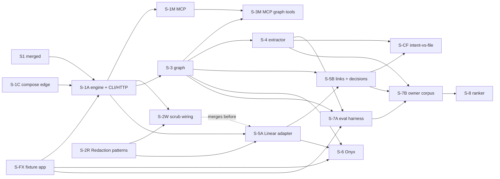

# Sindri context retrieval engine: the product graph and its retrieval (design)

Status: decisions settled in conversation with the owner, question by question, 2026-10-10; revised the same day
after the `/autoplan` review (§14). This is the written spec for review; it goes to `/specToProvenPR` once approved.
It refines the factory addendum §17.3 (the context graph), §17.29.2 and §17.29.3 (the engine, and access from
sessions) and §17.17 Q2 (component options), for build step 3 of §17.29.4 (stage S3 in `docs/csharp/sindri.md`).
Where they disagree, this document wins for the context retrieval engine.

Read with: addendum `2026-10-09-sindri-factory-addendum.md` §17.3, §17.8, §17.26, §17.29; core spec
`2026-10-07-sindri-design.md` §6.2 (code index), §7.5 (scoping and backtest), §8.3–§8.4 (trust, scrubbing), §11.2
(adapters); `.agents/rules/csharp.md`; `docs/csharp/redaction.md`; S1's `docs/csharp/sindri.md` (on
`feat/sindri-s1-app-shell` until it merges); issue #75. The TS `sindri/` scope and index modules are a reference for
*what* today's sources read, never for how.

## 1. Purpose and the premise we corrected

The engine answers questions an engineer asks before and during work, joined across three things:

- **intent:** what the business asked for and decided (Linear projects, PRDs and TDDs, comments, Slack threads);
- **the product:** its features and surfaces, how they nest, what state they share, and what a change to one cascades
  into ("Layout organizer > Split Pane > Orientation" affects the tab manager's layout restore);
- **implementation:** where each feature lives in code and what it does.

**Premise corrected.** The starting framing was "the pieces exist; add a retrieval layer on top." Measured against the
repo and the market, that is not right:

| Piece | Where it stands |
|---|---|
| Business intent and hybrid search | Exists as products (Onyx, Atlassian Teamwork Graph, Unblocked, Glean). Commodity: consume, don't build |
| Code index | Exists in TS only, organized by file and symbol (§6.2), TS/JS parser only. The C# rebuild is its own block (§17.29.4 step 4) |
| **Product graph** (features, surfaces, state, cascade) | **Does not exist.** §17.3 gives it one table row. No product surveyed builds it (§13) |
| **The join** (intent ↔ product ↔ code) | **Does not exist.** Edge names only |
| Retrieval and fusion across layers | Small, once the graph exists |

So the core deliverable is the **product graph and the links between layers**. Retrieval is cascade expansion over
that graph plus rank fusion across adapters.

```
 Intent layer      Linear projects · Linear Documents (PRDs, TDDs) · issues · comments · Slack
   (native Linear adapter + Onyx, live; Sindri stores refs and derived links only)
        │  decides · mentions        Decision nodes (Sindri's wording + verbatim quote)
        ▼
 PRODUCT GRAPH     Feature ─part-of─► Feature · Surface · Action · Thing · Flow      ← Sindri owns, SQLite
        ▲  implements (file level from Phase 4, symbol level from Phase 9) · tests
        │
 Code layer        files · symbols · modules · call graph (git, then the code index block)
```

## 2. Decisions and their reasons

| # | Decision | Reason |
|---|---|---|
| D1 | The core deliverable is the product graph plus cross-layer links, not an adapter layer | §1. It is the only part nobody else builds, and every query is anchored on it |
| D2 | **Onyx (community edition) is the business-intent search engine**, run unmodified and scoped by its own connector settings. Not ConnectAI | Owner's decision. MIT outside `ee/`, about 55 connectors, a free-edition MCP server, federated (live) Slack search. No fork: connectors and hybrid search are what its team improves weekly |
| D3 | **Onyx is used for recall only; Sindri owns ranking** | Onyx's OpenSearch path fuses one vector and one keyword query by min-max normalization with fixed 0.5/0.5 weights, with no reranker, no recency and no document boost (read at Onyx `main` 268e4d5a3d, 2026-10-05: `backend/onyx/document_index/opensearch/search.py:81-93`, TODOs `:157-160`; `hybrid_alpha` and `recency_bias_multiplier` passed by `context/search/pipeline.py:317-318` but unused there). Re-checked against the pinned release in the Onyx phase |
| D4 | A **native read-only Linear adapter** for project structure | Onyx's Linear connector reads issues and comments only (`connectors/linear/connector.py:231-341`): no projects, no Linear Documents (where the owner's PRDs and TDDs live), no project updates, no issue↔PR attachments |
| D5 | One separable package, **`Aw.Context`**, with no Sindri imports, reached through **one facade port** in its Core (§4) | §17.3 Reuse, and the C# rule that another package is reached only through its Core |
| D6 | **No rate limiting** in the adapter contract | Every source is on the machine: Onyx on loopback, repos, the index. A per-query deadline stays |
| D7 | `affects` (the cascade) is **computed at query time** over typed steps (§6.1), never stored | Stored, it goes stale on every edge change |
| D8 | Human edits are an **override layer** that survives every rebuild and every key-scheme change | Ring 1 runs in `assist` mode: the extracted map is a draft until the owner confirms it |
| D9 | **Decision** is its own node: Sindri's wording, citing a verbatim quote, with `supersedes` | What "what was decided about X?" must return |
| D10 | Results carry typed **conflicts**, outside the token budget: code is the truth for behavior, decisions are the truth for intent | Disagreement is shown, never cut or resolved silently |
| D11 | **MCP ships in Phase 1**, with HTTP and the CLI | The owner's Claude Code sessions are the main consumer |
| D12 | The first deployment target is the **owner's work product** (ring 1) | The owner's three related Linear projects are the backtest corpus. A fixture app serves the test lanes |
| D13 | The reranker is a **backtest arm, off by default** | It ships only if it beats graph-and-intent ranking (§9) |
| D14 | Profile-supplied extra scrub patterns go **into `Aw.Redaction`** | One scrubber for the whole build |
| D15 | **Trust follows provenance, not node type**: anything a model wrote from untrusted text stays untrusted and fenced until a human accepts it | Otherwise a prompt injection in a ticket returns to a session in Sindri's own voice (§14 S-H3) |
| D16 | One **canonical record key** across adapters, deduplicated before fusion. Linear records key on Linear's immutable UUID (`linear:issue/<uuid>`); the human identifier (`ENG-482`) is an alias, because it changes when an issue moves team | The same issue arrives through Onyx and through the native adapter (§14 A-F5) |
| D17 | Phase order: **native Linear before Onyx** | The owner's PRDs and TDDs are Linear Documents, which only the native adapter reads, and Onyx waits on company-OAuth sign-off (§14 P-2). The owner confirmed the earlier order; this change is flagged for approval in the PR |

## 3. Constraints and operating rules

- **Ring 1:** work accounts only, human-gated, `assist` mode (§17.17 Q5). **No Prism** on this profile (§17.3).
- **Company OAuth:** connecting Onyx to company Linear and Slack is done by the owner, with sign-off. Sindri never
  connects a business source itself.
- **Model egress** sits behind profile switches, all off until approved: `context.labeling.enabled` (map labeling and
  decision extraction), `context.eval.adjudicator`, and `context.mcp.enabled` (whether sessions may read intent text
  through MCP at all; a session reading it sends it to the model provider).
- **State** lives under `$AW_SINDRI_HOME/context/` (S1's app home, default `$AW_STATE_DIR/sindri-app`; never the TS
  `$AW_STATE_DIR/sindri/`): `context.db` and its `-wal`/`-shm` files, `eval/`, exports. Directories 0700, files 0600,
  set by `umask 077` on the process and checked by a test on all three SQLite files. Full-disk encryption is assumed.
- **Nothing lands in a git worktree:** map files, exports, eval corpora and reports are refused inside one (the
  `sindri scope` guard, SND-SCOPE-025, generalized as `SND-CONTEXT-005`).
- **Before the switch** (readiness §4a step 3): `~/.local/bin/sindri` is still the TS wrapper. The C# app runs as
  `dotnet run --project src/Sindri/Aw.Sindri.Host -- <verb>` or its published AOT binary; `docs/sindri/context.md`
  defines `SINDRI=<that command>` and every phase signal uses `$SINDRI`, never the TS `sindri`. Nothing in `setup.sh`,
  the providers or MCP registration points at the C# build.
- **API guard:** every `/sindri/context/*` route and `/mcp` sit behind S1's `LoopbackGuard` (loopback bind; a foreign
  `Host` is 400, any foreign browser `Origin` is 403), which stops DNS rebinding and cross-site posts. Integration
  tests assert both for `/mcp` and for each POST route.
- **MCP registration is per work repo, never user-wide:** `claude mcp add --transport http --scope local sindri
  http://127.0.0.1:<port>/mcp`, run inside the work repo, so personal-repo sessions (where Prism is registered) never
  see work context. Doctor check `context:mcp-scope` warns when a user-scope `sindri` server exists in
  `~/.claude.json`.
- **Decisions stay human:** the map review route records `human` provenance only from the CLI at an interactive
  terminal (the same rule as `profile approve`); there is no review tool over MCP.

## 4. Package shape and composition

```
src/Context/
  Aw.Context.Core            domain, the IContextEngine facade and its request/response records, ports, pure ranking,
                             packing and cascade, errors (SND-CONTEXT-*)
  Aw.Context.Features        slices behind the facade: QueryContext, ShowNode, Neighbors, Path, ImportMap, BuildMap,
                             ReviewMap, SyncSource, SourcesStatus, Eval*
  Aw.Context.Infrastructure  SQLite store (context.db), adapters (repo docs, Linear, Onyx, code), IngestSanitizer,
                             egress scrubber over Aw.Redaction, labeler (claude CLI), heavy-job lock, snippet purge
tests/
  Aw.Context.Tests           by slice; lanes unit / integration / heavy
  Aw.Context.Testing         fakes, builders, the adapter contract base, the fixture app and its recorded sources
```

**How Sindri reaches it (settles the composition question, §14 A-F1):**

- `Aw.Context.Core` exposes one facade port, `IContextEngine`, whose methods take and return records defined in
  Core (`ContextQuery`, `ContextResult`, `MapReviewBatch`, `SourceStatus`, `ContextSettingsCheck`, …). Sindri's
  Features, endpoints, CLI verbs, MCP tools, scheduled services and doctor checks use only those Core types, which is
  what ARCH-DIR-004 already allows. Inside `Aw.Context`, Features implements the facade by dispatching to its slices.
- Registration is the one thing that needs more: a new `deps.yaml` edge kind **`compose`** lets a Host call a
  lower-tier package's public `Add…()` registration methods (in its Features and Infrastructure) **and nothing else**,
  checked by `check-deps.mjs` (`DEPS-COMPOSE-001`) and an ArchUnitNET rule (`ARCH-COMPOSE-001`: no other type from
  those projects in the Host). Phase 1 lands the edge kind, its rule record and both checks. The same mechanism
  serves later blocks (Judge, Evidence).
- **Fan-out:** Sindri's package fan-out is at its limit of 4. The `compose` edge to `Context` carries a recorded
  `deps.yaml` exception: the context engine is one of Sindri's three engines by definition (§17.29.2), not a
  dependency of convenience. Like every exception it carries the schema's review date (`exceptionMaxDays`) and is
  renewed on review. S-1C also adds the `DEPS-PROJ-007` carve-out that lets a Host reference a `compose` target's
  Features and Infrastructure projects (for the `Add…()` calls only).
- **Profile key:** `SindriProfile` gains `Context: JsonElement?` (Sindri Core can't type it). Sindri validates it by
  calling `IContextEngine.CheckSettings`, so `profile validate` reports `context.*` errors with their key paths.
- **Secrets:** Sindri Host resolves the profile's secret pointers (`keychain:`, `env:`, `op:`, `file:` 0600) in
  `Composition` and passes the values to `AddContextInfrastructure(environment)` through the environment function;
  `Aw.Context` never resolves pointers or reads the keychain.
- **The labeler lives in `Aw.Context.Infrastructure`:** it calls the `claude` CLI (a declared `cli` edge; it moves to
  Judge's model runner once that lands, behind the same `ILabeler` port).
- **The heavy-job lock is a port, supplied by Sindri:** `IHeavyJobLock` is declared in `Aw.Context.Core`. Sindri
  Infrastructure implements **Sindri's own** lock port (Sindri Core) over the shared lock directory, for which Sindri
  already declares the file edge (two slots, `AW_HEAVY_SLOTS`). A small adapter in Sindri's **Host** wraps it as
  `IHeavyJobLock` and passes it to `AddContextInfrastructure`, because `DEPS-PROJ-008` allows a reference into another
  package's Core only from Features or Host. A tier-1 package taking the lock directly would be an upward file edge,
  which `check-deps.mjs` also refuses.
- **Tier 1** in `deps.yaml`. Project edges: `Aw.Kernel`, `Aw.Kernel.Data`, `Redaction` (Infrastructure only).
- Errors use the `SND-CONTEXT-NNN` catalogue (§8.6), following S1's `SND-<AREA>-NNN` convention.

## 5. Source adapters

### 5.1 Contract (`Aw.Context.Core`)

```csharp
public sealed record SourceRef(SourceId Source, ExternalId Id, SourceVersion Version, Uri? Permalink, RecordKey Canonical);
// Version: blob sha (repo docs) | commit sha (code) | updatedAt (Onyx doc, Linear doc and issue) | map version (graph).
// Canonical: one key per real-world record across adapters, e.g. linear:issue/<uuid> (alias ENG-482), linear:doc/<uuid>,
// slack:<channel>/<ts>, repo:<repo>/<path>. Each adapter maps its own ids to it. Onyx's Linear documents carry the
// mutable identifier (ENG-482), so the Onyx adapter resolves it through the alias table to the UUID key; an identifier
// with no alias yet is keyed `linear:pending/ENG-482` and merged into the UUID key when the native sync resolves it.
// The identifier is taken only from the structured metadata of Onyx documents whose source is Linear (never from text),
// must match `^[A-Z][A-Z0-9]+-[0-9]+$` with a team key from the profile, and decisions are never extracted from a
// pending record (they come from the native adapter's comments), so a merge never changes a decision key.

public interface IContextSource
{
    SourceDescriptor Describe();      // id, kind (Intent | Doc | Code), freshness (Live | Snapshot), as-of support
    ValueTask<Result<IReadOnlyList<SourceHit>>> Search(SourceQuery query, CancellationToken ct);
    ValueTask<Result<SourceRecord>> Fetch(SourceRef reference, CancellationToken ct);
    ValueTask<Result<IReadOnlyList<SourceVersion>>> Versions(IReadOnlyList<SourceRef> refs, CancellationToken ct); // batched
    ValueTask<SourceHealth> Probe(CancellationToken ct);
}

public interface IChangeFeed
{
    ValueTask<Result<ChangePage>> Changes(SourceCursor? after, int limit, CancellationToken ct);
}

public sealed record SourceQuery(IReadOnlyList<string> Terms, DateTimeOffset? AsOf, int Limit, TimeSpan Deadline);
public sealed record SourceHit(SourceRef Ref, string Title, int Rank, DateTimeOffset AsOf, bool Leaky);
public sealed record SourceRecord(SourceRef Ref, RecordKind Kind, string Title, string Text,
                                  string? Author, DateTimeOffset? CreatedAt, DateTimeOffset? UpdatedAt);
public sealed record ChangePage(IReadOnlyList<SourceRef> Changed, IReadOnlyList<ExternalId> Removed, SourceCursor Next);
```

- **Read-only by construction.** Credentials are read-only and least-privilege (§8.8); `context sources status`
  reports the scope each token actually has where the source exposes it.
- **Errors** (`Result<T>`): `Unavailable` (the query goes on without the source and reports `degraded`), `NotFound`,
  `Fatal`. No `RateLimited` (D6).
- **Freshness:** every hit carries `AsOf`. `Search`, `Fetch` and `Versions` are live; `Changes` drives a scheduled sync.
  A source that can't cut to `AsOf` returns `Leaky = true`.
- **Cursors** are persisted per source; a cursor advances only after the links from its page commit; replay is
  idempotent.
- **Deadline:** each call gets the query's remaining deadline; missing it counts as `Unavailable` for that query.
- **Adapters return raw text.** Sanitizing, scrubbing and trust tagging happen once, in the engine (§7).
- **Arguments are validated before they reach a process or a query:** git refs and shas match `^[0-9a-f]{7,64}$` or a
  ref-name rule, never start with `-`, and every git call puts `--` before paths; paths are repo-relative after
  normalization; FTS5 terms are quoted as phrases, never passed as `MATCH` syntax.

### 5.2 The adapters

| Adapter | Kind | Search | Fetch / version | Change feed | Phase |
|---|---|---|---|---|---|
| `repo-docs` | Doc | Lexical: SQLite FTS5 over **scrubbed** doc chunks at HEAD of the profile repos' doc globs | `git cat-file` at the blob sha; line spans | Commits touching the globs, run by a scheduled service (every 5 min by default) and on `context sources sync` | 1 |
| `linear` (native) | Intent | Title and key lookup only (Onyx searches issue text) | Projects, Linear Documents, project updates, issues **with their comments**, issue↔PR attachments; version `updatedAt`. Writes identifier → UUID aliases on every fetch | `updatedAt` filter, by the profile's teams | 5 |
| `onyx` | Intent | Onyx search (HTTP search API preferred; MCP `search` only if it exposes `updatedAt` and the federated lane), several sub-queries, top-k candidates | Onyx document by id; version `updatedAt` | Document listing by updated time (verified in Phase 6) | 6 |
| `code` | Code | Index lookup: symbol name, path, embedding neighbors | Symbol at a commit sha | Index rebuilds | 9 |

Files are a code-layer source from Phase 4 without the index block: the extractor reads them from git at a commit
sha (§6.1 `CodeUnit`).

**Dedup:** hits sharing a `Canonical` key are merged before fusion: one item, its best rank per source kept for RRF,
all source refs listed under one citation.

## 6. Data model

### 6.1 Graph

| Node | Meaning | Key example |
|---|---|---|
| `Feature` | A named capability; nested by `part-of` | `feature:layout.split-pane.orientation` |
| `Surface` | Where a person meets it. `kind`: screen, pane, dialog, command, keybinding, setting, menu, route, api, job | `surface:command/split-vertical` |
| `Action` | What a person or system does on a surface; preconditions, effects | `action:split-pane.split-vertical` |
| `Thing` | State or data the actions read and write, with its states | `thing:pane-layout` |
| `Flow` | An ordered path through surfaces and actions | `flow:open-tab-split-resize` |
| `Decision` | A decision in Sindri's own wording, citing a verbatim quote | `decision:<sha256(canonical record key ‖ quote span text)>` |
| `Record` (ref) | Pointer to an intent record, by canonical key | `record:linear:issue/ENG-482` |
| `CodeUnit` (ref) | Pointer to a file (from Phase 4) or symbol (from Phase 9) | `code:src/layout/SplitPane.ts` · `code:src/layout/SplitPane.ts#setOrientation` |

| Edge | From → to |
|---|---|
| `part-of` | Feature → Feature; Surface → Feature |
| `on` | Action → Surface |
| `moves-to` | Surface → Surface |
| `reads` / `writes` | Surface or Action → Thing |
| `depends-on` | Feature → Feature |
| `step-of` | Surface or Action → Flow (ordered) |
| `implements` / `tests` | CodeUnit → Feature, Surface or Action |
| `decides` | Decision → node |
| `mentions` | Record → node |
| `quotes` | Decision → Record (quote span) |
| `supersedes` | Decision → Decision |

Decision facts live in edges only (`quotes`, `supersedes`, `decides`); the `decision` table holds the wording and
quote span, nothing that an edge also holds. The key hashes the quoted record and span, so relabeling the wording
keeps the key and its overrides.

**The cascade (`affects`), computed per query over typed steps:**

1. **Own scope (free):** the anchor, its descendant features (reverse `part-of`), their surfaces (reverse `part-of`)
   and those surfaces' actions (reverse `on`).
2. **Steps (each costs 1):** a **state hop** (own-scope `writes` → Thing → another node that `reads` it, counted as
   one step); a **dependency hop** (reverse `depends-on`); a **flow hop** (the next node in a shared `Flow`).
3. **Ascend (free):** an affected surface or action resolves to its owning feature, reported as that feature; siblings
   are never expanded through `part-of` up-then-down. An ascended feature does not re-enter step 1: further steps start
   only from the reached surface or action, each costing 1 as usual.
4. Depth cap `context.cascadeDepth` (default 2), a visited set, and the shortest path reported per affected node.

Unit fixtures: Orientation → (writes `thing:pane-layout`) → the tab manager's layout-restore action reads it → tab
manager feature, at depth 1; and a sibling-exclusion case (Split Pane's sibling "Pane resize" is not affected unless a
step reaches it).

**Every node and edge carries** a stable key from a versioned `EntryKey()` (golden-snapshot tested) plus aliases;
provenance `deterministic | model | human` with a confidence; evidence `SourceRef[]`; and `computedAt` (map version,
commit sha).

**Override layer** (`map_override`): accept, reject, rename, merge, move, add and delete, applied over every rebuild.
- An `EntryKey()` version bump ships a **key migration** that writes old → new aliases for every node, so overrides
  and links follow the rename; a golden test asserts no override is orphaned by a migration.
- **Rejections are identified without versions:** (proposal kind, target key, evidence canonical keys and span
  hashes). An edit elsewhere in the cited doc does not re-propose a rejected node; an edit to the quoted span does.
- A link whose key disappears is `orphaned`, kept and queued for review (§8.7).
- Map versions are retained (the last 20 and every version a backtest sample cuts at), so overrides and as-of maps
  have their base.

**Model-suggested links** are used for recall, never as the only evidence for a surface (§17.3).

### 6.2 Storage

One SQLite file, `$AW_SINDRI_HOME/context/context.db`, through `Aw.Kernel.Data` (WAL, numbered migrations each tested
on a copy of the previous schema, hand-written ADO.NET with `IRowMapper<T>`). An integration test proves FTS5 is
available in the bundled `e_sqlite3` before Phase 1 relies on it.

| Table | Holds |
|---|---|
| `map_version` | id, repo, commit sha, extractor and key version, created, status (`building`, `draft`, `current`, `retained`) |
| `node`, `node_alias` | key, kind, label, attributes (JSON), provenance, confidence, trust, map version |
| `edge`, `edge_evidence` | from, to, type, provenance, confidence, map version; evidence refs |
| `map_override` | action, target key, payload, who (the OS user at the terminal), when, rejection identity |
| `decision` | key, wording, quote span, provenance, trust |
| `source_cursor` | source id, cursor, last sync, last error code |
| `snippet` | content hash, canonical key, version, scrubbed text, expires (14 days) |
| `doc_chunk` + FTS5 | repo-doc chunks, **scrubbed before indexing** |
| `query_log` | query id, HMAC of the query text (keyed per install), shape, anchors, result refs and ranks, timings, client (`cli`, `http`, `mcp`) |

- **Fetched live, never stored:** record text (Linear, Onyx), code text (git at the sha), search results. The snippet
  cache holds scrubbed citation snippets only, keyed by content hash, so text already sent to a model is never sent
  again.
- **Map builds write a `building` version in batches** and flip `current` in one short transaction, so syncs never
  wait on a long writer.
- **Purge:** a scheduled service deletes expired snippets and old map versions; doctor `context:retention` reports
  expired rows still present.

## 7. Scrubbing and trust

**Ingest:** every record crosses one boundary in `Aw.Context.Infrastructure`, once:

1. **`IngestSanitizer`** (new): removes HTML comments, invisible and control characters, encoded blobs over 200
   characters, remote images and link targets (keeping link text), repeating until stable (at most 5 passes). The TS
   `sanitizeIngest` is the reference for what it removes.
2. **`IRedactor.Scrub`** with the profile's extra patterns (D14). `Blocked` drops the text, keeps the ref, and
   marks that record's citation `state: "scrub-blocked"` (text withheld, ref kept).
3. **Every field from a record** gets the same treatment: title, author, permalink, ids used in attributes, and any
   alias or label proposed from record text. Titles and authors are collapsed to one line. Permalinks are kept only
   for allowed schemes and hosts (`https` on `linear.app`, the profile's Slack workspace domain, the loopback Onyx
   origin); others are dropped.

**Trust follows provenance (D15):**

| Content | Trust |
|---|---|
| Record text, titles, authors; code text | `untrusted` |
| Graph nodes and edges from deterministic extraction (registries, routes, paths); labels taken from code text are limited to identifier characters (`[A-Za-z0-9_.:/-]`), otherwise they are fenced like code text | `trusted` |
| Anything a model wrote from untrusted input (decision wording, labels, proposed aliases) | `untrusted` until a human accepts it, then `trusted` |
| Human overrides | `trusted` |

**Egress:** CLI, HTTP and MCP output all reach a model. An `IEgressScrubber` port (Core), implemented over
`Aw.Redaction` (Infrastructure), scrubs **per field** before serialization, so a `Blocked` field becomes
`[REDACTED:blocked]` in that field only and the response stays valid JSON; nothing ever falls back to the unscrubbed
value. Untrusted text is wrapped in the core spec's pack fence (§8.3: `<untrusted source="…" author="…">`), with
attribute values and body escaped by one escaper, so no field can close its own fence. The labeling pass scrubs code
and doc text before sending it.

**Stored text is already clean:** doc chunks, snippets, decision wording and model labels are scrubbed before storage.

**Logs and spans** carry codes, counts, hashes and timings, never query or record text (a Telemetry test plants
work-like text and asserts it never reaches a log line).

## 8. Query planner and surfaces

### 8.1 Shapes

Every shape resolves to **anchors**, then runs the same pipeline.

| Shape | Input | Anchors from | Phase |
|---|---|---|---|
| `text` | free text | Phase 1: none (the query terms go straight to the sources). From Phase 3: name and alias match over the graph, source hits vote, `suggestedAnchors` returned | 1, 3 |
| `node` | a node key, name or alias | direct | 3 |
| `item` | a Linear key or Sindri item | the record's `decides` and `mentions` links, keys in its text | 5 |
| `symbol` | a file path (Phase 4) or a symbol / `path[:line]` (Phase 9) | `implements` from the code unit | 4 (files), 9 (symbols) |
| `diff` | a ref range | changed files → nodes → cascade | not in this spec's phases |

### 8.2 Pipeline

1. **Anchors** (none for Phase-1 `text`).
2. **Expand:** cascade (§6.1) and neighbors to the depth cap.
3. **Candidates:** per source, sub-queries built from the anchors (names, aliases, parent feature, file and symbol
   names, ticket keys), or from the query terms when there are no anchors; each with `Limit` (default 50). Graph
   neighbors are ranked by cascade distance, then edge type. Source scores are discarded; only ranks are kept.
4. **Fusion:** first per source (best rank of an item across that source's sub-queries), then reciprocal rank fusion
   across sources and the graph list (`k = 60`), after canonical dedup (§5.2). This stops a source with more
   sub-queries from dominating.
5. **Features** (Phase 8): cascade distance, edge type, provenance, supersession, recency. Weights are profile values
   and registered artifacts (core §7.4), starting equal.
6. **Rerank** (Phase 8, arm only, off by default): a local cross-encoder or a budgeted model rerank of the top 30.
7. **Reformulate once** when fewer than `minHits` items clear the fused-score floor, within the deadline.
8. **Stale check:** one batched `Versions` call per source for the cited refs, skipped for a source already over its
   deadline (its citations then say `version unchecked`).
9. **Pack** into the budget, then **cite**.

No model call happens on the query path unless rerank is on.

### 8.3 Budgets and packing

The request carries `budget` (tokens, capped at `context.maxBudget`, default 32 000) and optional per-section caps
(the §17.8 injection plan). Sections, in fill order: `graph` (anchor facts, never cut mid-item), `affects` (the
cascade with paths), `decisions`, `code` (refs and signatures, not bodies), `records` (snippets). Within a section
items are filled greedily by score; overflow is listed as refs only ("+12 more"). **Conflicts and `degraded` sit
outside the budget and are always returned in full.** Tokens are estimated as UTF-8 characters / 4 and labeled
`estimate`. Server-side caps: depth ≤ 4, `path` length ≤ 8, `Limit` ≤ 200, record text ≤ 64 KB per record, one map
build at a time.

### 8.4 Result

```json
{ "schemaVersion": 1, "queryId": "q_01JC…", "query": {...}, "anchors": [...], "mapVersion": "v12@a41b07d",
  "asOf": "2026-10-10T18:02:11Z",
  "sections": [
    { "name": "affects", "items": [{ "kind": "feature", "node": "feature:tabs.layout-restore", "depth": 1,
      "path": ["feature:layout.split-pane.orientation", "writes thing:pane-layout", "reads action:tabs.restore-layout"],
      "provenance": "deterministic", "confirmed": true, "trust": "trusted", "cites": ["C4"] }] },
    { "name": "decisions", "items": [{ "kind": "decision", "node": "decision:…", "text": "…", "score": 0.031,
      "why": ["decides→feature:layout.split-pane.orientation", "rrf:linear#1,onyx#2"],
      "provenance": "model", "confirmed": false, "trust": "untrusted", "cites": ["C1"] }] } ],
  "conflicts": [{ "node": "…", "intent": ["C1"], "behavior": ["C3"], "summary": "…" }],
  "suggestedAnchors": [...],
  "degraded": [{ "source": "onyx", "code": "SND-CONTEXT-010", "message": "Onyx did not answer", "since": "…" }],
  "truncated": true, "budget": { "asked": 6000, "used": 5870, "estimate": true },
  "cites": { "C1": { "key": "linear:issue/ENG-482", "refs": [{ "source": "linear", "version": "2026-09-30T14:02:00Z" },
             { "source": "onyx", "version": "2026-09-30T14:02:00Z" }], "permalink": "https://linear.app/…",
             "trust": "untrusted", "state": "current" } } }
```

- No claim without a citation; every citation has a version. No version: `fetchedAt` with `version: "unstable"`.
  A version that no longer matches: `state: "stale"` with both versions. Not checked in time: `"unchecked"`.
- Every item carries `provenance`, `confirmed` and `trust`, so a session can tell a confirmed node from a draft.
- `why[]` lists the features that placed the item; `queryId` traces it in the query log.
- **Text output** (default for the CLI) renders the same content: a header line with the anchors and map version; a
  `DEGRADED` banner when any source is missing; sections as headings; items with `[Cn]` markers and `(draft)`
  for unconfirmed ones; conflicts in their own block before the sections; a sources table at the end. Status words are
  written out, never colour-only, and `NO_COLOR` is honoured. An example lives in `docs/sindri/context.md` (Phase 1).

### 8.5 Surfaces

All of them call `IContextEngine`; they differ only in transport.

| Surface | Shape | Phase |
|---|---|---|
| **HTTP** | `POST /sindri/context/query`; `GET /sindri/context/node?key=`; `GET /sindri/context/neighbors?key=&depth=`; `GET /sindri/context/path?from=&to=`; `POST /sindri/context/map/import`; `GET /sindri/context/map/export`; `POST /sindri/context/map/build`; `GET /sindri/context/map`; `GET /sindri/context/map/review`; `POST /sindri/context/map/review` (CLI-confirmed, §3); `GET /sindri/context/sources`; `POST /sindri/context/sources/sync`. Keys travel in query strings or bodies, never in the path (they hold `/` and `#`). Errors are ProblemDetails with the `SND-CONTEXT-*` code as `title` | 1 (query, sources), 3–4 (the rest) |
| **CLI** | `$SINDRI context query "<q>" [--node K \| --item ENG-1 \| --symbol S] [--depth N] [--budget N] [--json]`; `context show <key>`, `neighbors <key> [--depth N]`, `path <a> <b>`, `map import <file> \| export <file> \| build \| status \| promote \| review [--export F \| --apply F \| --history \| --undo ID]`, `sources status \| sync`, `eval backtest \| probes \| map` | as HTTP |
| **MCP** | Streamable HTTP at `/mcp` on the API port, **stateless mode** (so a Sindri restart doesn't break a session), behind the API guard. Read-only tools: `context_query {q, node?, item?, symbol?, depth?, budget?}`, `context_node {key}`, `context_neighbors {key, depth?}`, `context_sources {}`. Results: `structuredContent` with the result JSON, and a short text summary (anchors, counts, conflicts, degraded; not the full text a second time). Errors map to tool errors carrying the `SND-CONTEXT-*` code and fix. Off when `context.mcp.enabled` is false | 1 (`context_query`, `context_sources`), 3 (the rest) |
| **Workflow block** | `context.retrieve`: fills injection-plan sections for a recipe Step | 10 |

**Telling sessions to use it:** Phase 1 ships an agent-rules snippet in `docs/sindri/context.md` for the work repo's
own agent file ("before planning a change, call `context_query` for the feature or ticket; cite its `[Cn]`"), added
by hand, once S-1M's owner check shows the work repo returns useful results (if repo docs are thin there, hold the
snippet until S-5B brings the Linear documents); `context sources status` prints the registration and snippet status, and the number of MCP queries in the
last 7 days (counts from `query_log`, client `mcp`), so it's visible whether sessions actually use it.

### 8.6 Exit codes and errors

CLI exit codes: **0** results returned (possibly degraded); **1** no results, an unknown anchor, or a refused input
(e.g. a worktree path), with the fix; **2** tool error (the process isn't running, the profile is invalid, the store
can't open); **75** the heavy-job lock stayed busy (`map build`, `eval`). Long jobs print progress lines to stderr
(`waiting for heavy-job lock (slot 1/2 held by …)`, `extracting 412/1830 files`, `labeling 40/120`).

| Code | Meaning | Fix |
|---|---|---|
| `SND-CONTEXT-001` | `context:` profile section invalid (key path given) | Edit the profile, then `profile validate` and `profile approve` |
| `SND-CONTEXT-002` | A source named in the profile is not configured or its secret pointer doesn't resolve | Set the pointer (§8.8) and re-approve |
| `SND-CONTEXT-003` | Unknown anchor (node key, alias, item or symbol) | Use `suggestedAnchors`, or `context map status` |
| `SND-CONTEXT-004` | Store schema mismatch or the store can't open | A newer build migrates the store on start; a store newer than the build means updating the build. Never delete `context.db` (it holds review decisions); check `$AW_SINDRI_HOME` permissions |
| `SND-CONTEXT-005` | Output path inside a git worktree | Write outside repos |
| `SND-CONTEXT-010` | A source is unavailable (degraded, not fatal) | `context sources status` |
| `SND-CONTEXT-011` | **Every** source is unavailable (exit 2, not "no results") | `context sources status`; start Onyx or check the repos |
| `SND-CONTEXT-020` | MCP is disabled (`context.mcp.enabled: false`); `/mcp` answers 403 with this code and `context sources status` says so | Enable it in the profile and approve |
| `SND-CONTEXT-030` | No map yet | `context map import` or `context map build` |
| `SND-CONTEXT-040` | The heavy-job lock stayed busy | Retry; the message names the holder |
| `SND-CONTEXT-041` | Map review needs an interactive terminal | Run it at a terminal, or `--apply` a reviewed file there |
| `SND-CONTEXT-042` | Labeling disabled or over its token cap | Enable `context.labeling` or raise `maxTokens` |
| `SND-CONTEXT-043` | Review file is from an older map version | `map review --export` again |
| `SND-CONTEXT-050` | A source's token lacks a needed read scope | Recreate the key read-only with the listed scope |
| `SND-CONTEXT-070` | Onyx not on a loopback address, or its pinned version differs | §8.8 |

The full list, with HTTP status and MCP mapping, is kept in `docs/sindri/errors.md` (C# section) as phases add codes.

### 8.7 Map review

The step that turns the draft map into the confirmed one.

```
$ $SINDRI context map review
map v13 (draft, a41b07d) · 46 proposals · 3 orphaned links
 deterministic (31)            accept all deterministic? [y/N] y      ← bulk accept, deterministic only
 model (15), by impact (nodes they would link):
  1/15  feature:layout.split-pane.orientation  "Orientation"  0.82   evidence: src/layout/SplitPane.ts, linear:doc/…
        [a]ccept  [r]eject  [e]dit name  [m]ove under…  [s]kip  [q]uit
 orphaned (3): link record:linear:issue/ENG-301 → feature:layout.drag (key vanished)
        [r]epoint  [d]rop  [s]kip
```

- **Map version lifecycle:** `map build` writes a `draft`; queries read the `current` version (`--draft` reads the draft);
  `map review` works on the latest draft; `map promote` (or emptying the review queue) makes it `current`, and the old
  one `retained`. `--apply` works on the latest draft only; entries whose targets still match are applied and the rest
  listed as skipped (`SND-CONTEXT-043` only when nothing matches). `map review --history` lists overrides with their ids
  for `--undo`.
- The queue is ordered by impact (how many links and decisions hang on a proposal), deterministic proposals can be
  accepted in bulk, and every action is one `map_override` row.
- **Non-interactive form:** `map review --export review.yaml` writes the queue outside repos; the owner edits it;
  `map review --apply review.yaml` applies it **at an interactive terminal** (it prints the counts and asks for
  confirmation).
- `--apply` refuses a file exported from a map version that is no longer current (`SND-CONTEXT-043`, fix: export
  again); quitting mid-queue keeps every decision made so far, and the next `map review` resumes the rest.
- `map review --undo <override-id>` reverses one decision (a reject included), itself recorded as an override.
- Rename, merge, move, add and delete are also available as `map review` subcommands for nodes outside the queue.

### 8.8 Profile and setup

```yaml
context:
  repos: [work-app]                       # profile repos the engine maps; default: all
  docs: { globs: ["docs/**/*.md", "**/PRD*.md", "**/TDD*.md"] }
  cascadeDepth: 2
  deadline: 4s
  maxBudget: 32000
  minHits: 3
  scrub: { extraPatterns: [{ id: acme-customer-id, pattern: "ACME-[0-9]{6}" }] }
  labeling: { enabled: false, maxTokens: 400000, maxTokensPerSync: 50000 }
  mcp: { enabled: false }                # off until approved (§3)
  sources:
    linear: { token: "keychain:linear/work-read", teams: [ENG, APP] }   # url: Linear's API host (or loopback, tests)
    onyx: { url: "http://127.0.0.1:3000", token: "keychain:onyx/sindri-read", version: "<pinned tag>" }
  eval: { adjudicator: false }
```

Defaults are what's shown; `profile validate` reports any `context.*` error with its key path.

**Linear key:** a personal API key created with read-only permission, stored with `security add-generic-password -s
linear -a work-read -w`; `context sources status` checks it can read projects, documents and issues of the listed
teams.

**Onyx setup (Phase 6 deliverable, `docs/sindri/onyx.md`):** a pinned Onyx release (the tag, not `latest`, recorded in
the profile and checked by doctor); the compose file's published ports bound to `127.0.0.1`; the local embedding model
server, with no cloud LLM or embedding provider configured; Onyx telemetry off; connectors scoped (Linear from a start
date covering the backtest projects; Slack federated or the product's channels; docs connectors limited to the
product's spaces); an Onyx API key with the narrowest role that can search, stored by pointer. Doctor
`context:onyx` checks the loopback bind, the version and that the key can search. The no-cloud-provider and telemetry-off
settings can't be read with a search-only key, so the setup doc lists them as a manual check on each Onyx version change. First indexing time is reported by
`context sources status` from Onyx's own connector status.

## 9. Evaluation

### 9.1 Corpus

The owner's three related Linear projects on the work product: PRDs and TDDs (Linear Documents), issues with decisions
in comments, and the PRs that shipped them.

- **Unit: the issue.** Every issue with a merged PR is a sample. Brief = the issue and its project's PRD and TDD as of
  the issue's creation. Truth = **files** its PRs changed (from git; PR titles and branch names carrying the issue key
  fill missing attachments), mapped to nodes through file-level `implements` **of that sample's as-of map** (below), so truth never uses a node
  that didn't exist at the cut. Symbol-level truth joins in Phase 9.
- **Before Phase 7 starts**, the eligible-sample count is taken and recorded. Below 30, the gate becomes: the owner
  enables a layer by a recorded decision, with the numbers and `small sample` shown, and no layer is enabled
  automatically.
- **As-of cut per sample (no leak through the graph):** the map used for a sample is built **at the cut commit** with
  the extractor version under test (**deterministic extraction only, no labeling pass**, so a backtest makes no
  model calls for maps; cached by commit sha and extractor version), plus only the overrides dated before the cut. Hand-authored imports count as
  overrides with their import date. Repo docs at the cut commit's blobs. Linear and Onyx records created after the cut
  are dropped; ones edited after it are kept and labeled `leaky`. Whether Linear's API exposes document content history
  is checked in Phase 5; without it, PRD text is labeled leaky.
- The corpus stores refs and versions only and re-fetches text on each run; reports live under
  `$AW_SINDRI_HOME/context/eval/` with a 90-day TTL and `context eval purge`.
- The adjudicator (two runs in reversed order, agreeing answers only) labels surfaces no PR touched, behind
  `context.eval.adjudicator`.

### 9.2 Evals

1. **Scope recall:** node recall and precision; file-level recall@20.
2. **Map quality:** node and link precision on the owner's accept/reject decisions; **unmapped rate** (files changed
   in a quarter that map to no node).
3. **Probe set:** about 30 questions the owner confirms once; precision@5 and citation correctness. The probe runner
   ships in Phase 3, so every later phase's signal includes "probes don't regress".

### 9.3 Arms

- Dimension: brief-only baseline · `docs` · `linear` · `onyx` · `code` · `graph` · `all`.
- Ranker: RRF only · RRF + features · + rerank · Onyx `Limit` 20 vs 50.
- A layer or ranker stage is enabled only when its arm improves recall without dropping precision below the bar (or,
  below 30 samples, by the owner's recorded decision). **The product graph itself is never gated off:** its backtest
  arm sees only unreviewed deterministic maps at each cut (the owner's review comes later), so its number is a floor,
  reported for tracking; a `graph+reviewed` arm, labeled leaky, shows the ceiling. The `onyx` arms rerun once S-6
  merges, without blocking S-7B. Swapping an adapter is an evolve proposal judged on the same arms.

### 9.4 Pass bars (starting values; re-set after the first real runs, recorded in the ledger)

| Metric | Bar |
|---|---|
| Node recall / precision | ≥ 0.60 / ≥ 0.60, recall above brief-only |
| File recall@20 | ≥ 0.50 |
| Probe precision@5 | ≥ 0.80 |
| Citation correctness | 1.0 |
| Map node precision | ≥ 0.80 |
| Unmapped rate | ≤ 0.20 |
| Query latency p95 (local, warm) | ≤ 2 s without rerank, ≤ 5 s with |
| Backtest token budget | ≤ 1.5M tokens per run |
| Map labeling | ≤ `context.labeling.maxTokens` per build; decision extraction ≤ `maxTokensPerSync` per sync, the rest queued |

## 10. Test strategy by lane

| Lane | What |
|---|---|
| `unit` | Domain types and keys (`EntryKey` golden snapshot, key migrations writing aliases, alias resolution); cascade fixtures (Orientation → layout restore at depth 1; sibling exclusion; cycles; depth cap); per-source then cross-source RRF; canonical dedup; feature scoring; packing (section order, refs-only overflow, conflicts and degraded outside the budget, never cutting a graph fact); citation states (`stale`, `unstable`, `unchecked`); `IngestSanitizer` cases (the TS fixtures rewritten as behavior examples); fence and attribute escaping (titles, authors, permalinks, aliases); permalink allowlist; trust by provenance; per-field egress scrub with a `Blocked` field; argument validation (leading `-`, ref syntax, FTS phrase quoting); exit-code mapping; result JSON round-trips through `AwJson`; typed ids |
| `integration` | `context.db` migrations on copies of the previous schema; FTS5 present in the bundled `e_sqlite3`; file modes of db, WAL and SHM; override layer surviving a rebuild and a key-version migration; rejection identity across a doc edit; batched build and flip; adapter contract base against every adapter and fake (`repo-docs` on a temp git repo; `linear` against a recorded GraphQL fake; `onyx` against `FakeOnyxServer`); HTTP routes through `WebApplicationFactory`, including the foreign-`Host` 400 and foreign-`Origin` 403 on `/mcp` and every POST; the MCP endpoint through the MCP SDK client (tool list, a `context_query` round trip, a planted secret scrubbed, a planted injection fenced); CLI verbs against a running test host; map review `--apply` refused without a terminal; logs carry no planted text; the eval harness on the fixture app with a fake model |
| `heavy` | Map extraction on the fixture app with graphify; the full backtest on the fixture corpus; AOT publish of the Sindri host with the MCP endpoint (stateless mode) |
| manual | Phase signals in the running app; the real backtest and probes over work data, with evidence written outside repos |

**The fixture app** (`tests/Aw.Context.Testing/Fixtures/split-panes/`) is a small terminal-style app (a command
registry, keybindings, a settings file, two features sharing a `PaneLayout` state) in a git repo built by the test
setup, with a recorded Linear project (a PRD document, six issues, two decisions, one superseded, one conflicting with
the code), recorded Onyx responses for the same, and merged-PR history so the backtest has truth. Every adapter and
fake passes `ContextSourceContract<TSource>`. Tests never touch work data or the network.

## 11. Dependencies on S1 and others

| Needed | By phase | State |
|---|---|---|
| S1 merged: process, `ControlPlaneClient`, `CommandTable`, `EndpointTable`, `LoopbackGuard`, doctor, profile v1 | 1 | On `feat/sindri-s1-app-shell`, not merged. **Phase 1 needs it merged** |
| `SindriProfile.Context: JsonElement?` (optional key, joins v1) | 1 | Added by Phase 1 |
| `IScheduledService` (repo-docs refresh, syncs, rebuilds, purge) | 1 | In S1 |
| The `compose` edge kind and Sindri's fan-out exception (§4) | 1 | Built by Phase 1 |
| MCP host (`ModelContextProtocol.AspNetCore`, a new reviewed package in `Directory.Packages.props`) | 1 | Built by Phase 1 (AOT approved for servers in the readiness spike) |
| Secret pointer resolution in Sindri Host `Composition` | 5 | Built by Phase 5 |
| Heavy-job lock: port in `Aw.Context.Core`; Sindri's own lock in Sindri Infrastructure, adapted in Sindri Host (§4) | 4 | Built by Phase 4 |
| Model runner | 4, 7 | `claude` CLI adapter in Phase 4; Judge's runner once #156 lands |
| Code index block (§17.29.4 step 4) | 9 | Its own spec |
| Workflow engine (§17.29.4 step 2) | 10 | Its own spec |
| Onyx running, pinned, scoped, loopback-bound, with company OAuth signed off by the owner | 6 | Owner, at setup (§8.8) |

## 12. Open items (each owned by the named phase)

- Whether Onyx's HTTP search returns `updatedAt` and the federated Slack lane (Phase 6; fall back to Onyx's MCP
  `search` only if it does both).
- An Onyx change feed by updated time (Phase 6); without one, links are re-derived from search hits and the gap is
  reported by `context sources status`.
- Linear document content history for as-of cuts (Phase 5).
- Feature weights (Phase 8), starting equal.
- Where this engine meets TS `sindri scope` before the switch: none. `sindri scope` keeps running as it is; the scoping
  workflow (§17.29.4 step 5) is rebuilt on this engine later.

## 13. Prior art

| Who | What we take |
|---|---|
| Atlassian Teamwork Graph + Code Context (CLI for coding agents) | A CLI and MCP as the agent surface; permissions at query time |
| Unblocked (architecture write-up) | Parallel semantic, lexical, structural and temporal retrievers; authority/recency/relevance; code = behavior truth, specs = intent truth; one reformulate step |
| context-graph (MIT, local) | Rules-first linking: issue keys, URLs, quoted titles, paths and function names in text; the tools' own links; one person across tools; model-added decisions backed by quotes; never re-send text already read |
| Pendo | Surface anchors from UI elements; suggested features a human confirms |
| linecheck MVP (owner's, ADR-4/6/8) | Places, moves, actions, things, flows with `codeRefs` and confidence; static extraction plus one labeling pass; a cascade. Generalized here beyond web routes |
| Onyx, Potpie, Cognee, Graphiti | Considered as cores and rejected: none models product surfaces; Onyx stays as the intent search engine |

None of them has a product layer, and none publishes retrieval evals, so §9 decides.

## 14. Review findings and answers

`/autoplan` ran five lenses on the first draft (reviews under
`~/.agentic-workflow/jthorare-agentic-workflow/plans/2026-10-10-sindri-context-retrieval/`). No CRITICAL findings.
Every HIGH finding is fixed in this revision; MEDIUM and LOW findings are fixed or answered below.

**HIGH, fixed:**

| Id | Finding | Fix |
|---|---|---|
| A-F1 | The `compose` edge couldn't carry Phase 1: endpoints and MCP need Features types; Sindri's fan-out is at 4 | §4: the `IContextEngine` facade in Core; `compose` limited to `Add…()` registration; a recorded fan-out exception; where every Sindri-side adapter lives |
| A-F2 | `affects` couldn't reach its own headline example at depth 2 and expanded siblings | §6.1: typed steps, free own-scope and ascend, state hop as one step, visited set, fixtures |
| A-F3 / P-1 | Eval truth needed `implements`, which only arrived in Phase 9 | §9.1 and Phase 4: file-level `implements` from the extractor |
| A-F4 | The backtest's graph arm leaked future knowledge | §9.1: per-sample maps at the cut commit with overrides dated before it |
| A-F5 | No canonical record identity across adapters | D16, §5.1 `Canonical`, §5.2 dedup |
| S-H1 | User-wide MCP registration exposed work context to personal sessions | §3: per-repo `--scope local`, doctor `context:mcp-scope` |
| S-H2 | Routes didn't state their Host/Origin checks | §3: S1's `LoopbackGuard` on every route and `/mcp`, with tests. No bearer token: S1's threat model (honest mistakes), and the Host and Origin checks already stop rebinding and cross-site posts |
| S-H3 | Model-written text from untrusted sources became trusted | D15, §7 trust table, unit test |
| S-H4 | Onyx's own exposure (bind, providers, telemetry) | §8.8 Onyx setup, doctor `context:onyx`, `SND-CONTEXT-070` |
| D-1 | No CLI-runnable path before the switch | §3 `$SINDRI` |
| D-2 | State dir collided with the TS sindri | §3 `$AW_SINDRI_HOME/context/` |
| D-3 | No error catalogue | §8.6 |
| D-4 | Graph keys in URL paths | §8.5 keys in query strings or bodies |
| D-5 | No profile example or defaults | §8.8 |
| D-6 | No Onyx or Linear setup guide | §8.8, `docs/sindri/onyx.md` in Phase 6 |

**MEDIUM and LOW, fixed in place:** profile key as `JsonElement` validated by the facade (A-F6); per-field egress
scrub (A-F7, S-M2); scrubbed doc chunks and a refresh service (A-F8); override durability (A-F9); decision key and
single source of truth (A-F10); fusion inputs defined (A-F11); batched stale checks (A-F12); lock and secrets placed
(A-F14); decision-extraction budget (A-F15); pattern example uses `[0-9]` and an id without `/` (A-F16); MCP stateless
mode and error mapping (A-F17); FTS5 test (A-F18); one fence format (A-F19); snippet purge (A-F20); batched builds
(A-F21); identifiers in scrub patterns (S-M1, via D14 and Phase 2); attribute and permalink handling (S-M3); argument
validation (S-M4); human-only review (S-M5); least-privilege keys (S-M6); no text in logs, client in the query log
(S-M7); SQLite file modes and corpus retention (S-M8); `context.mcp.enabled` (S-M9); server-side caps (S-M10); pinned
Onyx and a reviewed MCP package (S-M11); HMAC query hashes (S-L1); MCP tool arguments and non-duplicated results
(D-M); `schemaVersion` and `queryId` (D-M); docs per phase (D-M); fixture app defined (D-M); exit codes, empty
states, the `affects` section, `confirmed` and `provenance` per item, conflicts outside the budget, degraded detail,
progress lines, text output and `NO_COLOR` (G-1…G-4); map review flow (G-3); probe runner in Phase 3 (P-3); agent
rules snippet (P-4); small-corpus gate (P-5); impact-ordered review with bulk accept (P-6); Linear before Onyx (P-2,
D17).

**Answered, not changed:**

- **A-F13** (Phase 5's conflicts promised code before Phase 9): the Linear and Onyx phases detect intent-vs-intent
  conflicts only (two current decisions on the same node that disagree, model-checked under the labeling budget).
  Intent-vs-behavior conflicts arrive with code: file level in stage S-CF (after both S-4's file links and S-5B's
  decisions exist) for "a decision cites a file the map says implements something else", and symbol level in Phase 9.
- **S-L2** (outbound targets): the only outbound calls are to the Linear API URL and the Onyx URL from the profile.
  `linear.url` defaults to Linear's API host (`https` only) and accepts a loopback URL only when the token is an `env:`
  or `file:` pointer (the fixture's fake server), so the real keychain token never goes to a local listener; the fake
  servers never log the `Authorization` header;
  `onyx.url` accepts only loopback. No URL from record text is ever fetched.
- **S-L3** (pathological profile patterns): `Aw.Redaction` compiles extra patterns with its match timeout and
  rejects patterns that break its pattern rules at `profile validate`; a timeout fails closed (`Blocked`).
- **S-L4** (map import input): `map import` validates against a versioned schema, is all-or-nothing, and refuses a
  file inside a worktree.
- **S-L5** (a local process calling the API as the owner): out of scope under the threat model (honest mistakes, not a
  hostile local user); recorded here as accepted.
- **P-L1** (no "done" line): this spec is done at Phase 8 for the owner's use; Phases 9 and 10 are tracked here and
  start when their blocks exist.
- **P-L2** (identifier patterns arrive after Phase 1): Phase 1 serves repo docs only, whose secrets the built-in rules
  cover; Phase 2 lands before any intent source.
- **D-L1** (fusion over one source in Phase 1): intended; Phase 1 proves the pipeline shape, and fusion becomes
  meaningful in Phase 3.

**Round 2** (`/autoplan` on revision 3, reviews under `…/plans/2026-10-10-sindri-context-retrieval/round2/`): design
PASS; product, architecture, devex and security NEEDS_WORK, no CRITICAL. Round-1 HIGHs were confirmed resolved. New
HIGHs, fixed:

| Id | Finding | Fix |
|---|---|---|
| R2-1 (product, arch N1, devex) | Pre-numbered migrations break `Aw.Kernel.Data`'s no-gap rule under parallel merges | Named migrations numbered on the branch they sit on, renumbered on rebase, frozen at merge; only throwaway homes run unmerged ones |
| R2-2 (security N1, devex, arch N10) | Stage owners would hand-test against real work sources from a personal repo, and share the owner's home, port and profile | Per-stage `AW_SINDRI_HOME`, port and fixture profile; real-source signal parts become owner checks with count-only records; PR text checked for work identifiers |
| R2-3 (arch N2, N9; product M5) | Missing DAG edges: S-7A needs S-4, S-3's MCP tools need S-1M, S-6 needs S-3; S-4's conflict check needs decisions | Edges added; S-3M split out; intent-vs-file conflicts became stage S-CF |
| R2-4 (arch N3) | A tier-1 lock adapter is an upward file edge | `IHeavyJobLock` port in Core, implemented in Sindri; §14 A-F14 answer corrected |

Also fixed: a stage-owner brief overriding `/specToProvenPR`'s epic defaults (devex); owners stay assigned until merge
and do their own rebases; the lead is the only `stages.md` writer; caps on ready-unmerged PRs and stack depth; a token
budget per stage; S-2W as its own stage, merging before S-5A; `context.mcp.enabled` defaults to false; MCP usage
counts in `sources status` (P-4); every-source-down is exit 2 (`SND-CONTEXT-011`); `scrub-blocked` as a citation state;
stale review files refused (`SND-CONTEXT-043`), resume after quit, `--undo`; cascade behaviour after ascend; truth
mapped through the sample's as-of map; as-of maps deterministic-only and cached; Linear canonical keys on the UUID; the
`symbol` shape's phases; fixtures stated synthetic. **Answered:** the fan-out exception follows the schema's review date like any
exception (round 3 corrected an earlier answer here); S-1A's size is measured at its plan step, and it splits if over M.

**Round 3** (final, `…/round3/`): product, devex and security PASS; architecture NEEDS_WORK on one HIGH, fixed:

| Id | Finding | Fix |
|---|---|---|
| R3-1 (arch) | Owner checks would run a PR's unmerged migration against the real `context.db`, whose review decisions can't be rebuilt | Owner checks run in a scratch owner-check home with the real profile copied in; prior state seeded by `map import`, never by copying `context.db` |

Also fixed in round 3: the fan-out exception carries the schema's review date and S-1C adds the `DEPS-PROJ-007`
carve-out (R3-2, correcting the round-2 answer); stack on at most one unmerged dependency (R3-3); Onyx's Linear
records resolved to the UUID key through aliases (R3-4); the loader's migration file form (devex); `linear.url`
limited to Linear's host or loopback, fixture tokens by `env:`/`file:` (devex); escalations go to the lead, restart
resume source (devex); the AOT-smoke publish path and clearing throwaway state on renumber (devex); a denylist file for
the PR identifier check (security N4); code-text labels limited to identifier characters (security L-a); the stale
phase text (S-2W, wave numbers, migration names, Phase 4's `symbol` shape). **Accepted as LOW, not changed:** the
`context:onyx` doctor check can't read Onyx's provider and telemetry settings with a search-only key, so §8.8's setup
doc lists them as a manual check on each Onyx version change; node truth excludes files a PR created (they have no
node at the cut, and recall is measured on what could have been anticipated); evidence for CI-only stages (S-1C,
S-FX) is their test and check output; as-of map caches are purged with old map versions by the retention service.

**Round 4** (`…/round4/`): product and security PASS; architecture, design and devex NEEDS_WORK on three HIGHs,
fixed:

| Id | Finding | Fix |
|---|---|---|
| R4-1 (arch) | A lock adapter in Sindri Infrastructure referencing `Aw.Context.Core` fails `DEPS-PROJ-008` | Sindri Infrastructure implements Sindri's own lock port; a Host adapter supplies `IHeavyJobLock` (§4; corrects R2-4) |
| R4-D (design, devex, arch, product) | Owner checks seed state from a map export that no verb produced | `context map export` in S-3, keeping original timestamps and provenance, restored on import |
| R4-X (devex, arch, design, security) | The owner-check home: a broken path when `AW_SINDRI_HOME` is unset, shared across stages, the real port, approval, services, MCP clash, no cleanup | A per-stage scratch home under `AW_STATE_DIR`, created fresh, its own port (7480), profile edited and approved there, `sindri-ownercheck` MCP name, teardown; a fixed `owner-check.md` outline |

Also fixed in round 4: the denylist check is a script that prints only locations and counts, over the PR title, body
and commits too (security R4-1); `linear.url` loopback only with fixture tokens, fakes never log credentials (R4-3);
pending Linear keys only from structured metadata and never a source of decisions, native comments fetched (R4-4,
arch R4-4); S-5A writes identifier aliases, so S-6 dedups without waiting on S-5B; the graph is never gated off by
its floor-only backtest arm, Onyx arms rerun after S-6; the map-version lifecycle (`draft`, `promote`, `current`) and
partial `--apply`; `--history` for `--undo` ids; MCP-disabled code `SND-CONTEXT-020`; the `SND-CONTEXT-004` fix no
longer suggests a rebuild; the S-1C row names both carve-outs and declares the exception with its edge; the stacking
intro matches the one-parent rule; the agent-rules snippet waits for useful results. **Accepted as LOW:** owner time
isn't sized beyond the "Gates that stay sequential" list; `confirmed` means a node or edge has `human` provenance or
was accepted in review.

## Parallel delivery with an agent team

The phases below are delivered by `/specToProvenPR`, run by an **agent team** so that agents are always working on
every stage that is unblocked, instead of one stage at a time. Each stage is still exactly what `/specToProvenPR`
requires: one PR, planned, built with TDD, tested by hand in the running app, evidenced, reviewed to zero blocking
findings, then stopped at the human merge gate. What changes is that several stages are in flight at once, each in its
own worktree and its own throwaway Sindri home, coordinated by a lead.

### Stages and their dependencies

Phases split into stages where part of a phase has fewer dependencies than the rest. One stage = one PR. A stage may
start once every dependency is merged, or all but one are merged and that one is open as a review-clean PR (it then
stacks on that branch).

| Stage | What | Depends on | Wave |
|---|---|---|---|
| **S-1C** | The `compose` edge kind: `deps.yaml` schema, `check-deps.mjs` (`DEPS-COMPOSE-001`), the ArchUnitNET rule (`ARCH-COMPOSE-001`), the `DEPS-PROJ-007` and ARCH-DIR-004 carve-outs for `compose` targets' `Add…()` calls, rule records, the fan-out exception (declared with the planned Sindri → Context `compose` edge in the same PR, so it suppresses a real edge), `scripts/denylist-check.sh` | — (no S1 needed) | 0 |
| **S-2R** | `Aw.Redaction` extra patterns from configuration, validated and compiled with the match timeout | — | 0 |
| **S-FX** | The fixture app and its recorded sources (§10), all **synthetic**, never captured from a real workspace: repo, Linear and Onyx recordings, merged-PR history, probe file, fake Linear and Onyx servers that replay them | — | 0 |
| **S-1A** | Phase 1a: `Aw.Context` package, facade, contract, sanitizer, egress scrubber, repo-docs, planner skeleton, HTTP and CLI | S1 merged · S-1C · S-FX | 1 |
| **S-1M** | Phase 1b: the `/mcp` host, `context_query` and `context_sources`, doctor checks, per-repo registration docs | S-1A | 2 |
| **S-2W** | Wiring `context.scrub.extraPatterns` into `Aw.Context` (XS) | S-1A · S-2R | 2 |
| **S-3** | Phase 3 without its MCP tools: graph store, overrides, cascade, `node`/`neighbors`/`path`, probe runner | S-1A | 2 |
| **S-5A** | Phase 5, first half: `linear` adapter (fetch, search, canonical keys, contract tests against the fake) and secret-pointer resolution | S-1A · S-2R; **merges after S-2W** | 2 |
| **S-3M** | Phase 3's MCP tools `context_node`, `context_neighbors` (XS) | S-1M · S-3 | 3 |
| **S-4** | Phase 4: extractor, file-level `implements`, map review | S-3 | 3 |
| **S-5B** | Phase 5, second half: sync, rules-first linking, decisions, intent-vs-intent conflicts, the `item` shape | S-3 · S-5A | 3 |
| **S-6** | Phase 6: Onyx adapter, dedup with Linear, Onyx setup doc and doctor | S-3 · S-5A · S-FX | 3 |
| **S-7A** | Phase 7, harness: corpus builder, per-sample as-of maps (from the extractor), arms runner, reports, on the fixture corpus | S-3 · S-4 · S-FX | 4 |
| **S-CF** | Intent-vs-file conflicts: a decision citing a file the map says implements something else (S) | S-4 · S-5B | 4 |
| **S-7B** | Phase 7 on the owner's corpus: eligible-sample count, the real backtest and probes. **Owner-run** (below) | S-4 · S-5B · S-7A | 5 |
| **S-8** | Phase 8: ranker features and the rerank arm (code on fixtures; the arm decision from an owner-run backtest) | S-7B | 6 |
| **S-9** | Phase 9: code adapter and symbol-level links | the code index block | blocked |
| **S-10** | Phase 10: the `context.retrieve` block | the workflow engine | blocked |

Critical path: S-1A → S-3 → S-4 → S-7A → S-7B → S-8.



### The team

| Role | Who | Does | Never does |
|---|---|---|---|
| **Lead** | The session that starts the epic (`/specToProvenPR` steps 0 and 0.5) | Is the **only writer** of `plans/<epic>/stages.md`: the table above, each stage's state, branch, base, port and home. Asks the autonomy question once (recommended: run continuously; stop only at merge gates). Starts a stage owner for every unblocked stage within the caps. Watches for merges and tells owners to rebase. Re-plans when a stage's scope changes. Reports to the human | Write product code or tests; merge; run anything against work data |
| **Stage owner** | One named teammate per stage (`stage-3`, …), started by the lead with `isolation: worktree`, assigned **until its PR merges** | Runs `/specToProvenPR` steps 1–9 for its stage only, under the brief below. Rebases its own branch when told, resolves conflicts, and redoes step 9's re-check (the journey once; `/review` again if the resolution touched non-test source). Reports each step change to the lead by message | Touch another stage's worktree; write `stages.md`; use the owner's Sindri home, profile, port or any real source |
| **Implementers** | Subagents of a stage owner (superpowers:subagent-driven-development) | Independent tasks inside one stage in parallel, each red-green with its own tests | Work across stages |
| **Reviewers** | `/review`'s own multi-agent fan-out, per PR | The review loop on each stage's PR | — |

**Stage-owner brief.** `/specToProvenPR` as it exists runs a whole epic from one worktree. Until it takes a stage id
(`--stage S-3`, a toolkit follow-up outside this spec), the lead gives each owner this brief, which overrides those
defaults:

1. You own stage `<id>` only. The lead has done steps 0 and 0.5; don't create an epic worktree or ask the autonomy
   question. Your worktree, branch and base (`main` or the dependency's branch) are `<…>`.
2. Steps 1–9 for this stage. Step 5 evidence: the stages are CLI, HTTP and MCP, which `verify-app` doesn't drive, so
   write the evidence pack by hand: the commands, their outputs, and the MCP tool calls through the SDK client, as the
   earlier C# stages did. Skip `/ui-evidence` with that reason.
3. Hand tests run in **your isolated environment only**: `AW_SINDRI_HOME=<scratch>/home-<id>`,
   `AW_SINDRI_PORT=<port>` (assigned by the lead from 7491 up), a profile built from the fixture app with
   repo-docs on the fixture repo and the fake Linear and Onyx servers, approved at a pseudo-terminal with `expect` in
   that throwaway home (the S1 hand-test pattern). Source tokens in that profile are `env:` or `file:` pointers to
   fixture values, never the owner's keychain, and the profile names only the sources its base branch supports.
   `$SINDRI` is the stage's binary published with `src/Sindri/aot-smoke/run.sh` (it publishes from a copy, so the
   worktree's lock files don't change), rebuilt after each rebase; a rebase that renumbers a migration also deletes the
   throwaway `context/` directory. Never point anything at the owner's home, port, profile, work repo, Linear or Onyx.
4. The phase signal is proven on the fixture app. The parts that need the work product, real Linear, real Onyx or a
   Claude Code session in the work repo are the **owner check** (below): write `owner-check.md` with the exact steps and
   what counts as a pass, and leave it to the human.
5. Every place the skill would ask the user or write `stages.md` goes to the lead by message instead: the review
   loop's cap of 5, a finding that sends the stage back to step 3, and step 9's status update. The lead decides or
   asks the human.
6. After step 9, report "ready" to the lead and stop. Don't start another stage. Stay assigned until the PR merges.
   After a restart, resume from your stage's row in `stages.md` and your `$STAGE_DIR` files.

### Work data stays with the owner

Stage owners run in the toolkit repo, which is a personal repo (Prism registered, PRs public). So no agent on the
team ever reads work data:

- Every signal part that needs real sources is an **owner check**, run by the human in the work repo after the PR is
  ready and before merging, from the stage's `owner-check.md`. It runs the PR's build against an **owner-check home**, never the real home, because the
  PR may carry a migration not yet numbered for `main`, and the real `context.db` (with the owner's review decisions)
  must only ever run merged migrations. `owner-check.md` follows one outline:
  1. **Build** the PR head with `src/Sindri/aot-smoke/run.sh` into a scratch dir.
  2. **Home:** `AW_SINDRI_HOME=${AW_STATE_DIR:-$HOME/.agentic-workflow}/sindri-app-ownercheck-<stage>`, created fresh
     (deleted first if present), with `AW_SINDRI_PORT=7480` so it never takes the real instance's port.
  3. **Profile:** the real profile copied in, then edited per the template: labeling off, scheduled services off
     except the ones the check names; approved in the scratch home at a terminal.
  4. **Seed** prior state, when needed, with `$SINDRI context map import` of a `context map export` taken from the real
     home (never a copy of `context.db`).
  5. **MCP**, when the check uses a session: register `sindri-ownercheck` (`--scope local`, port 7480) in the work repo,
     and remove it at the end.
  6. **Steps and pass criteria**, then **record** pass/fail and counts.
  7. **Teardown:** stop the process, remove the MCP registration, delete the scratch home and build.
  Stage owners never read or write an owner-check home. Its record in the PR is pass/fail and counts only
  (results, citations, sources), never text, titles, issue keys or project names.
- S-7B and S-8's arm decision are owner-run in full: the human runs the backtest and probes; agents get the aggregate
  report (numbers only) if they need it.
- Before marking a PR ready, the stage owner runs `scripts/denylist-check.sh <denylist> <files…>` over the PR title,
  body and commit messages (written to files) and `evidence.md` and `owner-check.md`. The denylist is a file the owner
  writes once outside every repo (team keys, the Slack workspace domain, `linear.app/<workspace>`, project names); the
  lead passes its path. The script prints only `file:line` and a hit count, never the matched words, and fails when
  the denylist is missing or empty, so no agent ever reads the work identifiers. Owners never open the file; a hit is
  removed by rewording the flagged line. The script lands in S-1C.

### Keeping agents busy

- **Caps:** at most **3 stages building** at once (the heavy-job lock has two slots that integration and heavy lanes
  take, so the third waits briefly; the owner's review bandwidth is the other limit), at most **4 PRs ready and
  unmerged**, and stacks at most **2 deep**. At either of the last two caps the lead starts no new building stage;
  owners do prep only.
- **A freed slot is filled at once** with the next ready stage: critical path first, then whichever unblocks the most.
- **Stacking:** a stage on an unmerged dependency branches from it and bases its PR on it. A stage stacks on **at most
  one** unmerged dependency; with two or more open, it waits until all but one have merged. When the dependency merges,
  the lead tells the owner, who rebases onto `main`, retargets the PR and redoes the step 9 re-check. A stage never
  stacks on a dependency with blocking findings.
- **Prep while blocked:** verification plans for upcoming stages, fixture and probe assets, `owner-check.md` drafts,
  the Onyx setup doc draft. None of it needs unmerged code or work data.
- **At the merge gate:** the lead tells the human which PRs are ready, in merge order, with each one's owner check, in
  one message per batch.
- **Token budget:** each stage owner reports its token use at every step change (scorer); a stage past 3M tokens
  pauses and the lead asks the human before continuing.

### Shared files

| Shared thing | Rule |
|---|---|
| `context.db` migrations | **Named, not pre-numbered.** A stage's migration file is `NNNN_<stage>_<name>.sql` (the loader's form: four digits, letters, digits and
`_` only, e.g. `0003_s5a_linear_cursor.sql`) with `NNNN` set to the next free number **on the branch it sits on**, and renumbered when it rebases onto a new base (a stage's migrations stay contiguous on top of its base, as `Aw.Kernel.Data`'s gap check requires). Number and content freeze at merge. Only throwaway homes ever ran an unmerged migration, so renumbering never touches a real `context.db` |
| `SND-CONTEXT-*` codes | Ranges per stage: S-1A `001–019`, S-1M `020–029`, S-3/S-3M `030–039`, S-4 `040–049`, S-5A/B `050–069`, S-6 `070–079`, S-7A/B `080–089`, S-8 `090–099`, S-CF `100–109`. §8.6 follows these ranges |
| `deps.yaml`, `Directory.Packages.props`, `AgenticWorkflow.slnx`, `.env.example` | Append-only edits within the stage's own block; the later PR's rebase resolves conflicts |
| `PublicAPI.Unshipped.txt`, Sindri's `EndpointTable`, `CommandTable`, JSON context, MCP tool list | One line or one block per slice; the later rebase keeps both |
| `docs/sindri/context.md`, `docs/sindri/errors.md` | One section per stage, headed by the stage id |
| `Aw.Context.Core` domain types | Owned by S-1A. A later stage adds the Core types it needs in its own PR; if two in-flight stages need the same new type, the lead gives it to the earlier one and the other stacks on it |

### Gates that stay sequential

- **Human merges.** Every stage stops at its merge gate; agents never merge.
- **Owner checks and the owner's own steps:** company-OAuth sign-off and Onyx setup (before S-6's owner check);
  `profile approve` of the real profile for each new `context:` key; map review on the real map; probe-set
  confirmation; S-7B and S-8's work-data runs.

### What the lead reports

One line per stage on every change, and on request:
`S-3  building  step 4 (hand test)  branch …  base S-1A (#…, ready)  port 7493  tokens 0.8M  blockers: none`.
`stages.md` is the single record, so `/specToProvenPR` resume mode works for the lead after a restart.

## Phases

Each phase is one PR, or the stages the table above splits it into. Sizes: XS ≤ 80, S ≤ 250, M ≤ 600 changed lines
of production code (tests excluded), L above (split before starting). Every phase ends with its signal shown in the
running app, with evidence written outside repos, and from Phase 3 on its signal includes "`$SINDRI context eval
probes` doesn't regress". Stage ids and waves are in "Parallel delivery" above. A signal step that needs the work
repo, real Linear, real Onyx or a session in the work repo is an **owner check**; stage owners prove the same signal
on the fixture app.

### Phase 1: `Aw.Context` skeleton, repo-docs adapter, planner skeleton, HTTP + CLI + MCP

- **Goal:** a usable first slice. A Claude Code session in the work repo asks Sindri a question and gets cited,
  versioned, scrubbed results from the repos' PRDs and plans.
- **Files:** `src/Context/Aw.Context.{Core,Features,Infrastructure}` (facade, contract §5.1, `SourceRef` with
  `Canonical`, result types, `IngestSanitizer`, egress scrubber, RRF, packing, citations, `QueryContext` and
  `SourcesStatus` slices, `repo-docs` adapter with scrubbed FTS5 and its refresh service, its `context.db` migration);
  `tests/Aw.Context.{Tests,Testing}` (contract base, fakes, fixture app skeleton); Sindri: `Context: JsonElement?`
  in the profile, routes, `context query` and `context sources status|sync` verbs, the `/mcp` endpoint (stateless,
  behind the guard) with `context_query` and `context_sources`, doctor `context:sources` and `context:mcp-scope`;
  `deps.yaml` (package, edges, `compose` edge kind, fan-out exception), `scripts/check-deps.mjs`, the ArchUnitNET
  rule, rule records; `Directory.Packages.props` (MCP package); `docs/sindri/context.md` (setup, `$SINDRI`, MCP
  registration per repo, the agent-rules snippet, a text-output example); `docs/sindri/errors.md` (C# codes);
  `.env.example` for any new variable.
- **Size:** L as listed, so three stages: **S-1C** (`compose` edge and checks: S, wave 0), **S-1A** (package,
  contract, sanitizer, scrubber, repo-docs, planner skeleton, HTTP and CLI: M, wave 1) and **S-1M** (MCP host and
  tools, doctor: S, wave 2). The phase is done when S-1M ships.
- **S1:** S-1A and S-1M need S1 merged; S-1C doesn't.
- **Signal:** `$SINDRI context query "split pane orientation" --json` returns cited `repo:` results with blob shas;
  in a Claude Code session in the work repo with Sindri's MCP added (`--scope local`), `context_query` returns the
  same; a planted secret in a doc comes back as `[REDACTED:…]`; a request with a foreign `Origin` gets 403.

### Phase 2: profile extra scrub patterns in `Aw.Redaction`

- **Goal:** ring-1 identifier shapes are scrubbed everywhere the build scrubs, before any intent source lands.
- **Files:** `src/Redaction/Aw.Redaction` (extra `RedactionRule`s from configuration, validated against the pattern
  rules, compiled with the match timeout), PublicAPI files, `docs/csharp/redaction.md`; `Aw.Context` wiring from
  `context.scrub.extraPatterns`.
- **Size:** S, as two stages: **S-2R** (the `Aw.Redaction` part, wave 0) and **S-2W** (the `Aw.Context` wiring, XS,
  wave 2). S-5A's owner check runs only once its base includes S-2W, so real Linear text is always scrubbed with the
  extra patterns.
- **S1:** none new.
- **Signal:** with `{id: acme-customer-id, pattern: "ACME-[0-9]{6}"}` approved, `$SINDRI context query` shows
  `[REDACTED:acme-customer-id]` where a doc held `ACME-123456`; an invalid pattern fails `profile validate` with
  `SND-CONTEXT-001`.

### Phase 3: product graph store, override layer, cascade, `node` / `neighbors` / `path`, probe runner

- **Goal:** the product graph exists and answers cascade questions, from a hand-authored map first; probes guard
  every later phase.
- **Files:** its `context.db` migration (graph, overrides, decisions, retention); `EntryKey`, aliases, key migration
  scaffolding; `ImportMap` and `ExportMap` (versioned schema, all-or-nothing, outside worktrees; an export holds nodes, edges, aliases, overrides and rejections **with their original timestamps and provenance**, and importing an export restores both, so `human` stays `human` and the backtest's as-of filter sees the real decision dates; round-trip test); `ShowNode`, `Neighbors`, `Path`;
  the cascade (§6.1) with fixtures; `node` shape, `graph` and `affects` sections; anchor resolution for `text`;
  routes, verbs, MCP `context_node` and `context_neighbors` (these two tools are stage S-3M, after S-1M); doctor `context:map` and `context:retention`; the probe
  runner (`eval probes`) and probe file format.
- **Size:** M.
- **S1:** `IScheduledService` (purge).
- **Signal:** after `$SINDRI context map import ~/…/product-map.yaml`, `$SINDRI context query --node
  feature:layout.split-pane.orientation --json` returns its subtree and an `affects` section with paths;
  `context_node` returns the same from a session; `$SINDRI context eval probes` prints precision@5 for the probe file.

### Phase 4: the extractor, file-level `implements`, map review

- **Goal:** Sindri proposes the map from the repo, with file-level `implements` links; the owner reviews it; overrides
  survive rebuilds.
- **Files:** extractor (deterministic anchors: command and keybinding registries, settings keys, routes, UI component
  names and test ids, each with the files that define it, as deterministic file-level `implements`; graphify clusters
  as candidate features; a labeling pass behind `context.labeling.enabled`); `BuildMap` (batched, draft then flip) and
  `ReviewMap` (§8.7, interactive and `--export`/`--apply`); the `symbol` shape in its file-path form (`--symbol
  <path>`, MCP `symbol`); `IHeavyJobLock`; `ILabeler` with the `claude` CLI
  adapter; a scheduled rebuild. (The intent-vs-file conflict check is stage S-CF, §14 A-F13.)
- **Size:** M (split extraction and labeling into two PRs if over).
- **S1:** `IScheduledService`.
- **Signal:** `$SINDRI context map build` prints proposed nodes with provenance, confidence and their files;
  `$SINDRI context map review` bulk-accepts deterministic ones and accepts or rejects model ones; a second build keeps
  every decision and re-proposes no rejected node; `--symbol src/layout/SplitPane.ts` resolves to its feature.

### Phase 5: native Linear adapter, secret pointers, sync, decisions, the `item` shape

- **Goal:** the owner's projects, PRDs, TDDs, issues and PR links enter the graph; decisions appear with quotes.
- **Files:** `linear` adapter (read-only GraphQL, team filter, canonical keys), secret pointer resolution in Sindri
  Host `Composition`, `SyncSource` and its scheduled service, the rules-first linker (§13), `Decision` extraction
  (labeling switch, `maxTokensPerSync`, queue), `supersedes`, intent-vs-intent conflicts, the `item` shape, the as-of
  check of document history (§12), the recorded Linear fake.
- **Size:** M, as two stages: **S-5A** (adapter, canonical keys, secret pointers, contract tests; wave 2, beside
  S-3) and **S-5B** (sync, linking, decisions, conflicts, `item`; wave 3).
- **S1:** `IScheduledService`.
- **Signal:** `$SINDRI context query --item ENG-482 --json` returns the issue's project PRD and TDD (`linear:doc/…`
  citations with `updatedAt`), the nodes it touches, its decisions quoting their source, and the PRs that shipped it.

### Phase 6: Onyx adapter

- **Goal:** semantic recall over issue and comment text and Slack joins the candidates, deduplicated with the native
  Linear records.
- **Files:** `onyx` adapter (HTTP search; §12 items resolved), canonical-key mapping from Onyx document links,
  `FakeOnyxServer`, doctor `context:onyx`, `docs/sindri/onyx.md` (§8.8).
- **Size:** S–M.
- **S1:** secret pointers (Phase 5).
- **Signal:** with Onyx scoped and loopback-bound, `$SINDRI context query --node <feature> --json` shows Slack threads
  with `onyx:` citations and Linear issues cited once with both `linear` and `onyx` refs; stopping Onyx gives
  `degraded: onyx` while graph and Linear results still return.

### Phase 7: evaluation harness

- **Goal:** the backtest and map-quality evals of §9, on the fixture corpus in CI and on the owner's corpus by hand.
- **Files:** corpus builder (issue samples, file truth from git, per-sample as-of maps, leaky labels), arms runner,
  adjudicator through `ILabeler`, report writer, `eval backtest | map | purge`; the eligible-sample count recorded
  first.
- **Size:** M, as two stages: **S-7A** (the harness on the fixture corpus; wave 4) and **S-7B** (the owner's corpus;
  wave 5, run alone).
- **S1:** heavy-job lock (Phase 4).
- **Signal:** `$SINDRI context eval backtest --arms all` prints per-arm node recall and precision, file recall@20 and
  the pass line for the owner's three projects, with sample count and leaky share.

### Phase 8: ranker features and the rerank arm

- **Goal:** stage-5 features and the optional rerank stage, each enabled only by a passing arm (or the owner's recorded
  decision below 30 samples).
- **Files:** feature scoring, weights as profile values and registered artifacts, rerank port with a local adapter,
  reformulate step.
- **Size:** S–M.
- **S1:** none new.
- **Signal:** `$SINDRI context eval backtest --arms ranker` shows RRF-only vs + features vs + rerank, and the profile
  enables only the stages that passed.

### Phase 9: code index adapter and symbol-level `implements`

- **Goal:** symbol-level implementation from the C# code index block; intent-vs-behavior conflicts at symbol level.
- **Files:** `code` adapter over the block's read-only db, symbol-level `implements` refining file-level links,
  `symbol` shape at symbol granularity, the symbol-level conflict check.
- **Size:** S–M.
- **S1:** none; **depends on the code index block**.
- **Signal:** `$SINDRI context query --symbol src/layout/SplitPane.ts:setOrientation --json` returns the features it
  implements, their cascade and their decisions.

### Phase 10: the `context.retrieve` workflow block

- **Goal:** recipes get retrieved context in their injection-plan sections.
- **Files:** the block, its contract tests, its registration with the engine.
- **Size:** S.
- **S1:** none; **depends on the workflow engine**.
- **Signal:** a design-studio recipe run shows a Step whose injection plan holds a cited `context` section, and the run
  receipt lists the citations.
