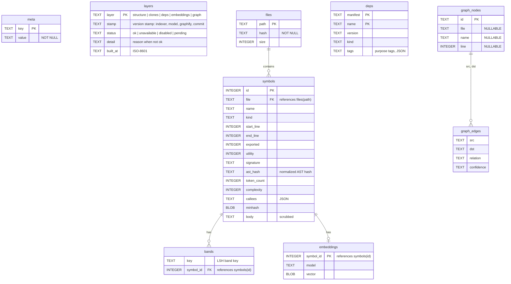

# Entity-Relationship Diagram -- Sindri

Sindri's SQLite stores. The MCP bridge's database left with the bridge (R2 stage B). Judge (`decisions.sqlite`:
`decisions`, `failures`, `briefs`) and scorer (`scorer.sqlite`: `files`, `calls`; one live file per session) keep their
own SQLite stores, defined by the migrations in their `src/db.ts`; this file doesn't document them yet.

## Sindri ledger

```mermaid
erDiagram
    meta {
        TEXT key PK "epoch"
        TEXT value "NOT NULL"
    }
    items {
        TEXT source PK "NOT NULL, <tracker type>:<repo>, e.g. plan-file:<repo>"
        TEXT id PK "tracker item id, unique only within its source"
        TEXT title "NOT NULL, scrubbed, <=200 chars"
        TEXT state "open | done | removed"
        TEXT size "XS..XL, NULLABLE"
        TEXT sized_by "rules | judge, NULLABLE"
        TEXT ambiguity "none | unknown, NULLABLE"
        INTEGER steps_done
        INTEGER steps_total
        TEXT content_hash "NOT NULL"
        TEXT first_seen "ISO-8601"
        TEXT last_seen "ISO-8601"
        INTEGER epoch "fencing epoch of the last write"
    }
    item_events {
        INTEGER seq PK
        TEXT source FK "with item_id, references items(source, id)"
        TEXT item_id FK
        TEXT ts "ISO-8601"
        TEXT kind "seen | changed | state-changed | removed"
        TEXT detail "scrubbed JSON, <=2000 chars"
        INTEGER epoch
        TEXT tick_id "ulid of the run"
    }
    profile_approvals {
        TEXT hash PK "sha256 of the approved bytes; the row inserted last (highest rowid) is the latest approval"
        TEXT approved_at "ISO-8601"
        TEXT approved_by "OS user"
    }
    cursors {
        TEXT source PK "adapter:repo"
        TEXT cursor
        TEXT updated_at
    }
    shape_runs {
        TEXT run_id PK "ulid"
        TEXT repo "NOT NULL"
        TEXT ts "ISO-8601"
        TEXT head "HEAD at record time, NULLABLE"
        TEXT tree "git write-tree of the staged index, NULLABLE"
        TEXT commit_sha "set by reconcile once a commit with that tree is found, NULLABLE"
        INTEGER elapsed_ms
        INTEGER index_age_ms "NULLABLE"
        TEXT providers "JSON: layer status at record time"
        TEXT parser "parse-ts@<INDEXER_VERSION>+ts<typescript version> that computed the AST hashes"
        TEXT deferred "JSON: checks skipped over the commit budget"
        INTEGER signal_count
        INTEGER epoch
        TEXT closed_at "set when a run is still unlinked at shape.outcomeDays: never links later, NULLABLE"
    }
    shape_signals {
        INTEGER seq PK
        TEXT run_id FK "references shape_runs(run_id)"
        TEXT type "e.g. reinvented:exact"
        TEXT layer
        REAL value
        REAL threshold
        TEXT at "file:line"
        TEXT existing "the matching existing symbol, NULLABLE"
        TEXT detail "scrubbed, names fenced as untrusted"
        TEXT name "flagged symbol or dependency, NULLABLE"
        TEXT ast_hash "flagged symbol hash, NULLABLE"
        TEXT outcome "kept | acted-on | dropped | n/a, NULLABLE until labeled"
        TEXT labeled_at "ISO-8601, NULLABLE"
        INTEGER epoch
    }
    scope_runs {
        TEXT run_id PK "ulid"
        TEXT subject "NOT NULL, the brief file or linear:<project>"
        TEXT mode "NOT NULL, scope | backtest"
        TEXT ts "NOT NULL, ISO-8601"
        TEXT status "NOT NULL, e.g. complete | incomplete"
        INTEGER rounds "NOT NULL"
        INTEGER surfaces "NOT NULL"
        REAL recall "NULLABLE, backtest only"
        REAL precision "NULLABLE, backtest only"
        REAL baseline_recall "NULLABLE"
        REAL baseline_precision "NULLABLE"
        INTEGER leaky "NOT NULL, 1 when the code index was used in a backtest"
        INTEGER tokens "NOT NULL"
        TEXT out_path "NOT NULL"
        INTEGER epoch "NOT NULL"
    }
    model_calls {
        TEXT run_id PK "correlation id, no foreign key (any Step's run)"
        TEXT step "NOT NULL DEFAULT 'scope': scope | backtest, later triage, reflect, ..."
        INTEGER seq PK "with run_id"
        TEXT role "NOT NULL, e.g. scoping | challenger | adjudicator"
        TEXT model "NOT NULL"
        INTEGER input_tokens "NOT NULL"
        INTEGER output_tokens "NOT NULL"
    }
    items ||--o{ item_events : "has"
    shape_runs ||--o{ shape_signals : "records"
    scope_runs ||..o{ model_calls : "audits (by run_id, not enforced)"
    artifacts {
        text id PK
        text kind
        text paths
        text root
        text hash
        int protected
        text suite
        text first_seen
        text changed_at
        text removed_at
        int epoch
    }
    suite_runs {
        int seq PK
        text artifact_id FK
        text hash
        text head
        int dirty
        int ok
        int exit_code
        int ms
        text ts
        int epoch
    }
    proposals {
        text id PK
        text artifact_id FK
        text source
        text kind
        text tier
        text status
        text title
        text norm_title
        text body
        text created_at
        text updated_at
        int epoch
    }
    proposal_public {
        text proposal_id PK, FK
        text body
        text judge_category
        text model
        text created_at
        int epoch
    }
    proposal_sources {
        text proposal_id PK, FK
        text session PK
    }
    comparisons {
        int seq PK
        text proposal_id FK
        int run
        text item_id
        text verdict
        text detail
        text ts
        int epoch
    }
    hook_samples {
        int seq PK
        text hook
        text ref UK
        text ts
        int warranted
        text reason
        text sampled_at
        int epoch
    }
    adoptions {
        int seq PK
        text prompt_id
        text proposal_id
        text sha256
        text adopted_at
        text adopted_by
        int epoch
    }
    evolve_audit {
        int seq PK
        text ts
        text verb
        text actor
        text detail
        int epoch
    }
    artifacts ||--o{ suite_runs : "has runs"
    artifacts ||--o{ proposals : "is changed by"
    proposals ||--o{ comparisons : "is compared in"
    proposals ||--o| proposal_public : "has a generalized version"
    proposals ||--o{ proposal_sources : "was built from"
```

`$AW_STATE_DIR/sindri/ledger.db` (SQLite, WAL, file 0600, dir 0700). Sindri is the only writer; hooks append to spool files instead (spec §5.2). The schema version is `PRAGMA user_version`; migrations live in `sindri/src/ledger/db.ts` and are append-only, run in one `IMMEDIATE` transaction, and copy the file to `ledger.db.bak-v<old>` first. A ledger newer than the running sindri is refused with `SND-LEDGER-001`.

Items are keyed by `(source, id)`: an item id is unique only within its tracker source, so two repos with a same-named plan file never share a row, and `markMissing` closes only its own source's items. `item_events` references that composite key.

Every write runs inside `withEpoch(db, epoch, …)` or `fenced(db, epoch, …)`, an `IMMEDIATE` transaction that rejects a stale epoch (spec §9.1): `withEpoch` throws `SND-LOCK-003`, and `fenced` returns `{ ok: false }` so `observe` can stop as a no-op. Re-approving a profile deletes and re-inserts its `profile_approvals` row, so a rollback becomes the latest approval.

Ledger v2 adds `shape_runs` and `shape_signals` (record-only shape signals; outcomes are labeled by tree reconcile once a commit is `shape.outcomeDays` old). The v1 to v2 migration keeps all rows and leaves `ledger.db.bak-v1`. Indexes: `shape_runs_pending (commit_sha, closed_at, ts)` for the runs waiting for a commit, `shape_runs_tree (repo, tree, parser, ts, run_id)` for the one-run-per-staged-tree rule, and `shape_signals_type`, `shape_signals_run`.

Ledger v3 adds `scope_runs` (one row per `sindri scope` run or backtest) and `model_calls` (one row per model call, keyed by `(run_id, seq)`, written in the same transaction as the run's row). `model_calls` audits every Step, not only scoping: `run_id` is a plain correlation id with no foreign key to `scope_runs` (a later Step such as triage or reflect has no `scope_runs` parent), and `step` names the Step that made the call (`scope` or `backtest` today; the column defaults to `scope`). The v2 to v3 migration keeps all rows and leaves `ledger.db.bak-v2`.

Ledger v4 adds the self-evolution tables (`artifacts`, `suite_runs`, `proposals`, `comparisons`, `hook_samples`, `adoptions`, `evolve_audit`; see `docs/sindri/evolve.md`). The relationships are logical: no foreign keys are declared (v5 declares the first two foreign keys on the evolve tables, `proposal_public.proposal_id` and `proposal_sources.proposal_id`; the others stay logical). `comparisons` rows with `item_id = '*'` are run markers (`running`, `errored`) or the run's summary. `evolve_audit` also holds the markers that say a reflect or correct run completed, and the two verbs `stage`'s generalize retry cap reads: `generalize-hold` (detail `<proposal id>: <reason>`, one per hold on a proposal's content; a failed model call writes none) and `generalize-retry` (detail `<proposal id>`, written by `sindri evolve retry`). The cap counts a proposal's `generalize-hold` rows after its latest `generalize-retry` row, by verb in SQL; deleting or pruning those rows resets it. The v3 to v4 migration keeps all rows and leaves `ledger.db.bak-v3`. Evolve's model calls are not written to `model_calls`.

Ledger v5 adds `proposal_public` (one row per proposal: the generalized, scrubbed `body` that `sindri evolve publish` renders, the judge's `judge_category`, the generalizing `model`, `created_at`, `epoch`). `proposal_id` is the primary key and references `proposals(id)`; the original proposal stays in `proposals`, local only. v5 also adds `proposal_sources` (primary key `(proposal_id, session)`, `proposal_id` references `proposals(id)`): the transcript sessions (prefixes as `transcript:<session>#<line>` refs use them) whose text `reflect` or `correct` sent to the model for a proposal, written by code when the proposal is saved, never taken from the model's answer, and only ever added to (a re-proposal merged into an open one adds its sessions, unless that one is a `reflect`/`correct` proposal with no row, which keeps none; an open `telemetry:` proposal, which has none by design, gets them). The verbatim layer checks them with the sessions the evidence cites. The row `-` records that the model read no transcript (`reflect` on a PR with no session on its branch); a `reflect`/`correct` proposal with no row at all holds at publish. The v4 to v5 migration keeps all rows and leaves `ledger.db.bak-v4`. A backup is never overwritten: the first copy of a version is kept (an exclusive copy, `COPYFILE_EXCL`, with no hard link, so filesystems without hard links work; a copy that fails part way removes its half-written file), so a racing opener can't replace it with a newer one. The only rollback is restoring that copy, which loses the writes made since (an older sindri refuses the newer ledger with `SND-LEDGER-001`). Keeping the first `.bak-v<N>` is deliberate: it is the only copy of the pre-upgrade ledger. Restoring a backup by hand is outside sindri's supported flows; after one, delete the stale `.bak-v<N>` before upgrading again, or the upgrade keeps the old file.

## Sindri code index

`$AW_STATE_DIR/sindri/index/<repo>.db`, one SQLite file per repo (schema: `sindri/src/index/db.ts`). It is derived data: a different `user_version` is rebuilt, not migrated, and a build writes a temp copy and renames it over the old file.

